# MP5-Baugruppe

Alle Teile der Waffe an ihrem Platz in einer Datei, erzeugt mit
[`../scripts/baugruppe.py`](../scripts/baugruppe.py) aus den Teilen von
[`../mp5_umbau/`](../mp5_umbau/) (vorher `umbau.py` laufen lassen):

- `mp5_baugruppe.glb` – farbig, jedes Teil ein eigener Knoten; Meter, y oben, Mündung in +x
  (Blender, Windows 3D-Viewer, gltf-viewer.donmccurdy.com)
- `mp5_baugruppe.3mf` – dieselben Teile in mm, Gun-Rahmen (für CAD/Slicer)

| Links | Linke Hälfte, linker Schaft und Magazin ausgeblendet | Schräg vorn links |
|---|---|---|
| 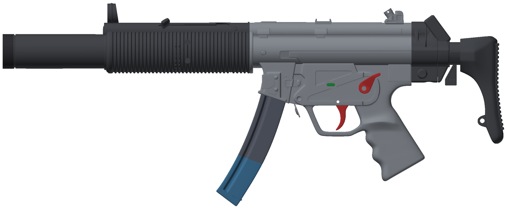 | 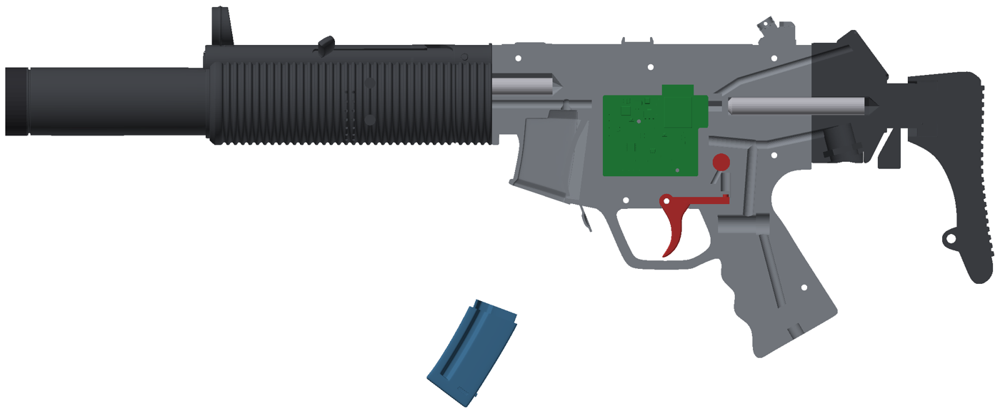 | 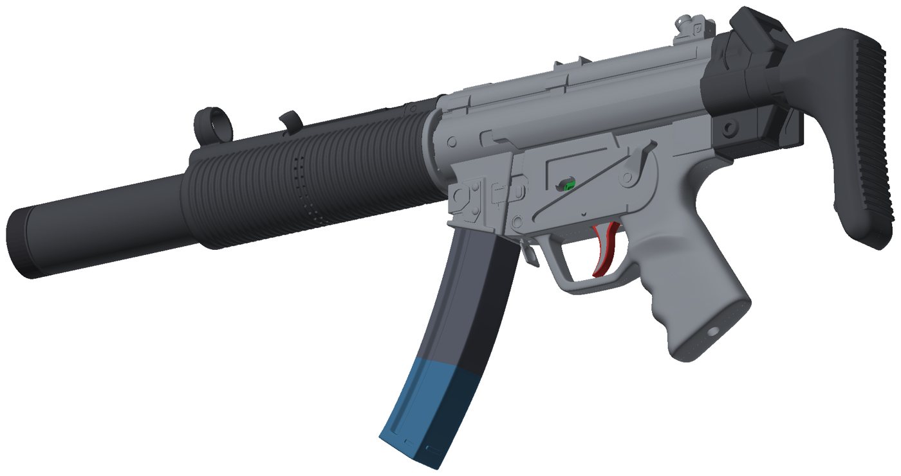 |

| Rechts (Schraubensenkungen an Gehäuse und Handschutz, Schalllöcher) | Vorn rechts (Frontkappe, Linsenhülse) | Hinten (OLED am Schaft) |
|---|---|---|
| 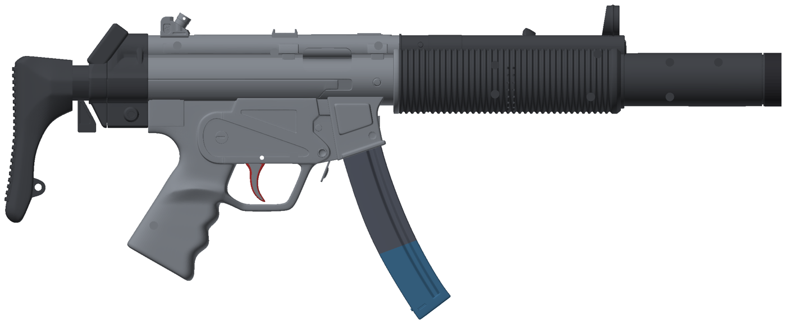 | 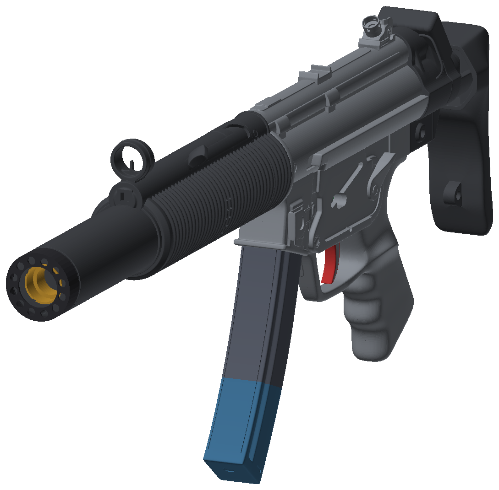 | 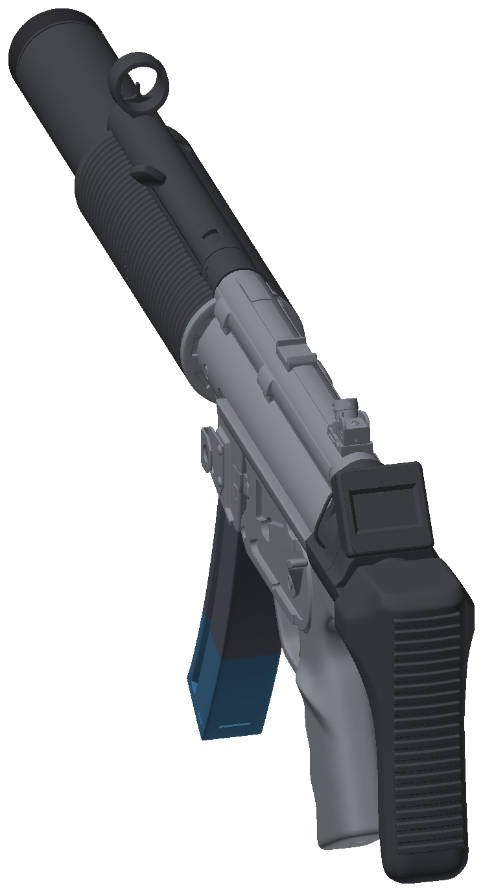 |

Externe Antenne links oben über dem ESP32-Modul (Platine als Variante mit ESP32-S3-WROOM-1U):

| Links | Schräg vorn links | Innen (linke Hälfte ausgeblendet) |
|---|---|---|
| 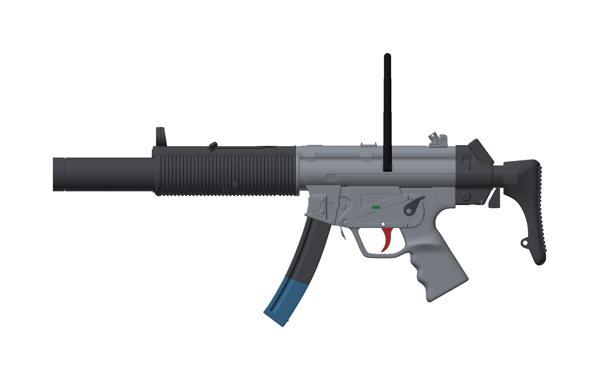 | 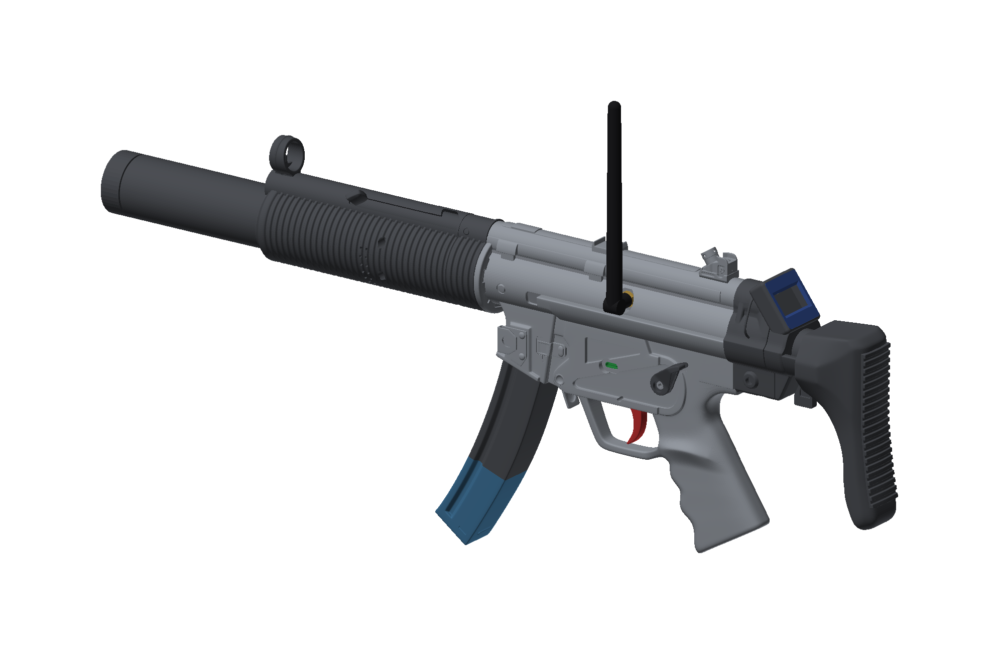 | 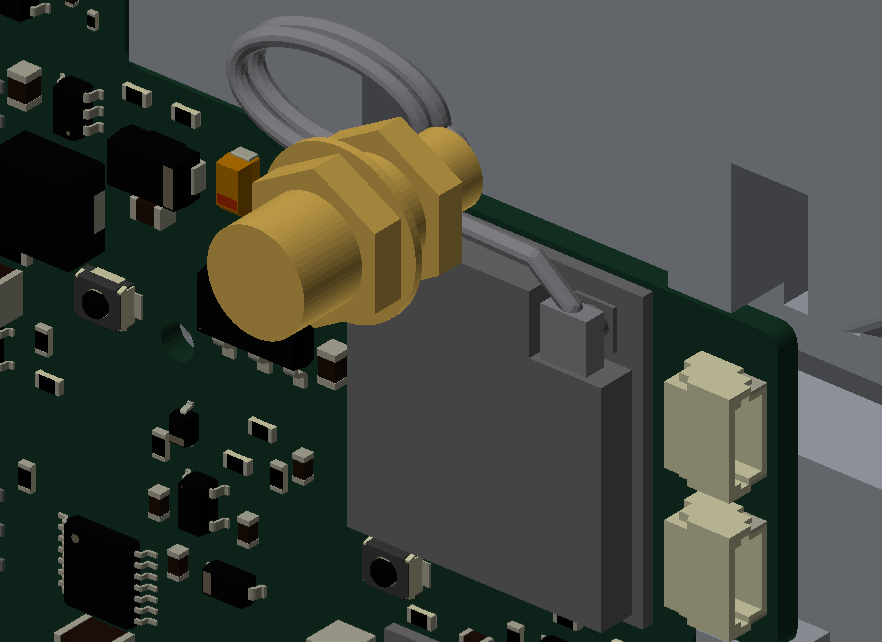 |

USB-C-Buchse (10,5 mm hoch) bündig in der Mulde der linken Seitenwand, rechts der Nachladehebel (rot, beweglich):

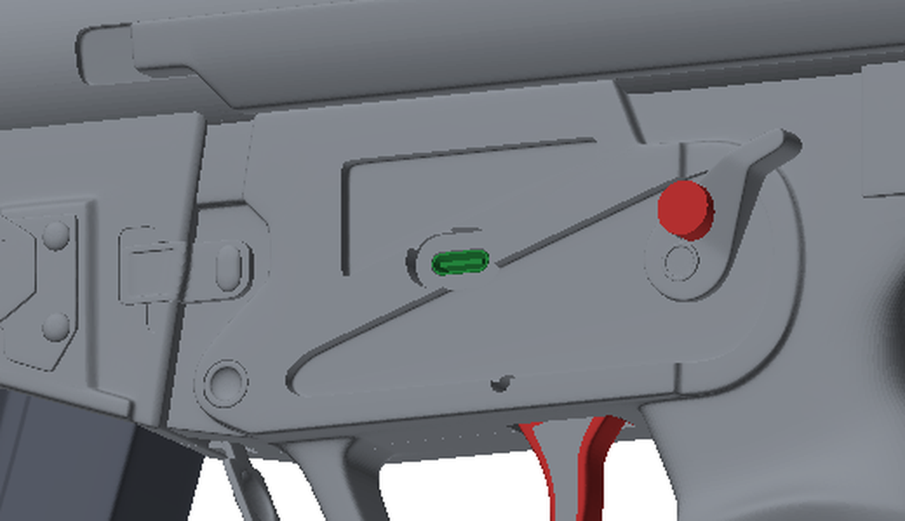

Explosionszeichnung (alle Druckteile, die Platine und die Antennenteile, Namen wie in [`../mp5_umbau/`](../mp5_umbau/README.md#dateien);
Kaufteile wie Schrauben, Akku und Lautsprecher sind nicht dargestellt):

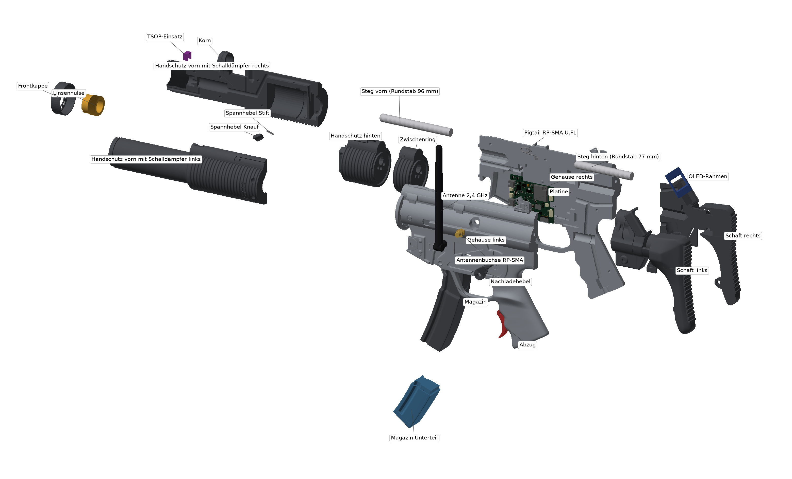

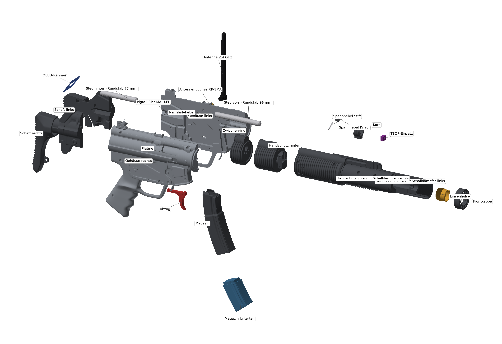

Schnitt durch den Schalldämpfer (Linse, IR-LED, Ringlicht als Platzhalter):

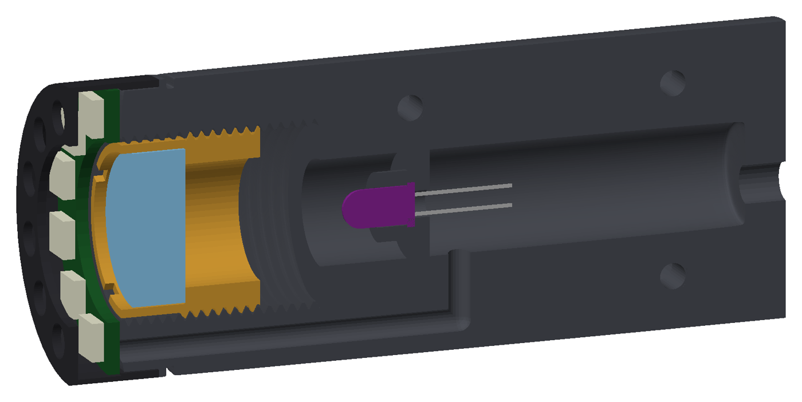

Schnitt durch den Handschutz (rechte Hälfte): Lautsprecher (rot, Platzhalter) strahlt nach hinten in die
Schallkammer mit Löchern, davor die geschlossene Basskammer, oben die Kabelnut und das Korn, rechts (blau)
der Zapfen des hinteren Handschutzes:

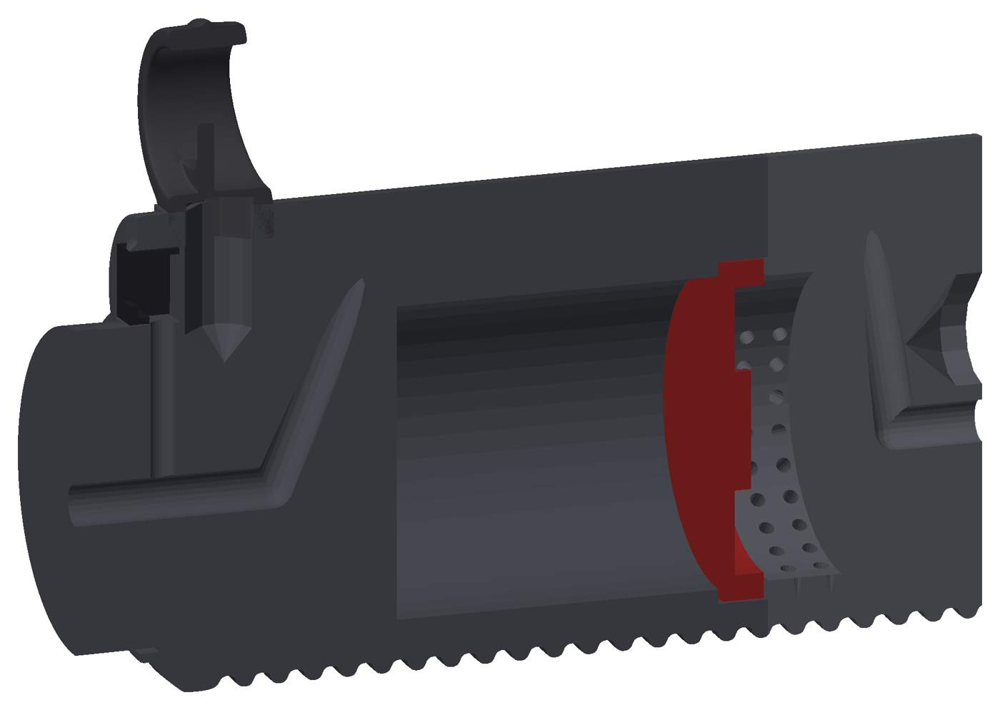

Schnitt durch Gehäuse und Schaft (rechte Hälfte): GX16-Buchse für die Weste (gold, Platzhalter, 15° nach hinten) mit
Mutter in der Sechskanttasche und Stecker, Westenschacht schräg nach vorn in den Motorschacht; darüber OLED-Schacht
und Steg hinten:

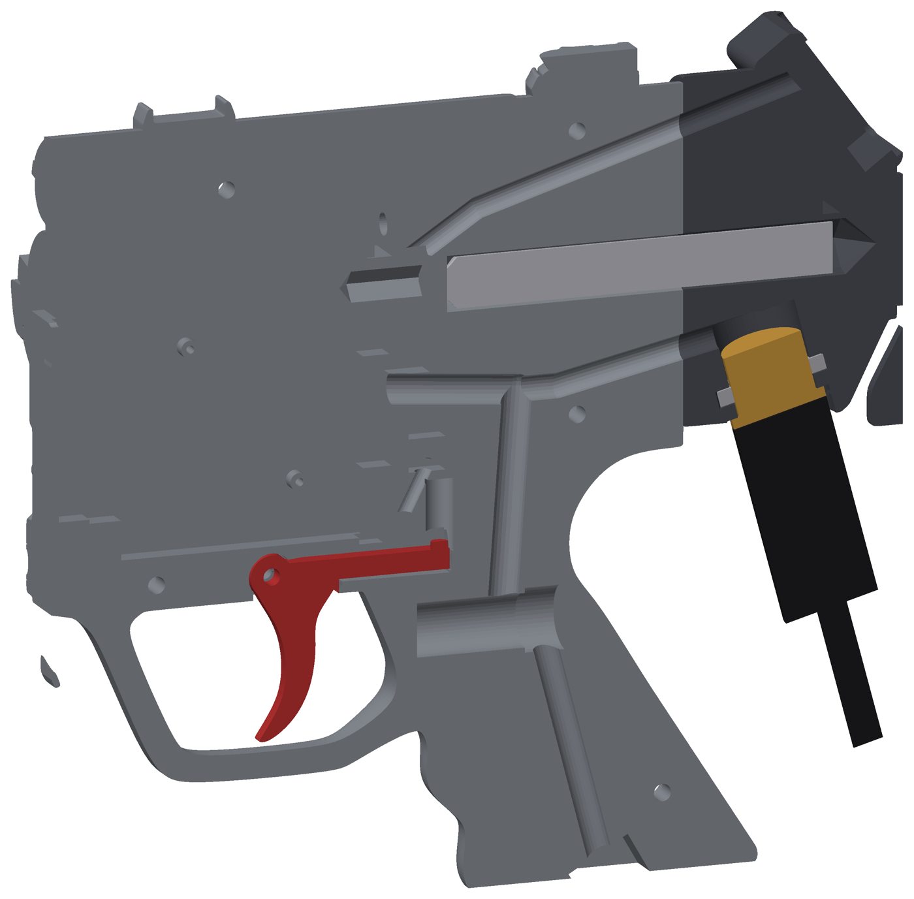

Verstärkung (Schnitt gestuft bei Z = −6,6 vorn und −9 hinten): Zuganker M4 (gold) vorn vom Zapfenkopf durch
Handschutz hinten und Zwischenring bis in das Gehäuse, hinten vom Gehäuse bis in den Schaft, Muttern in Nischen
bzw. gefangen; dazu Stege aus Stahl und Zentrierbunde am Zwischenring:

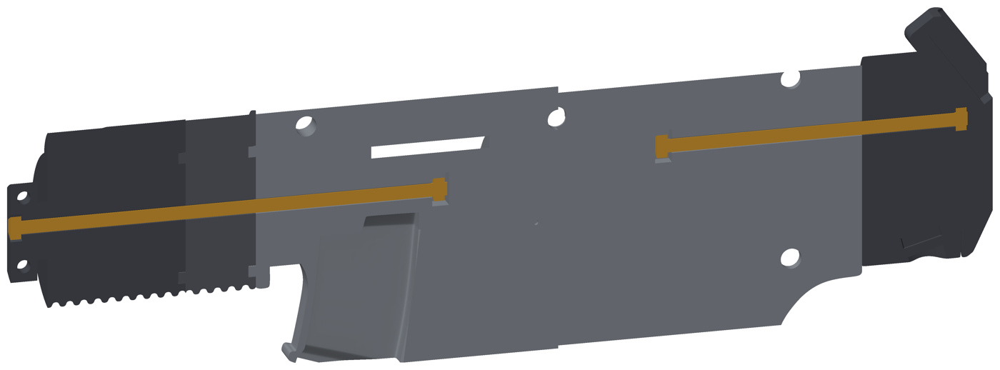

Nachladehebel (rot) abgehoben: Lagerbund mit Schraube in der Kreismarke, Stifte im Hebelboden, Taster 6 × 6
(liegend) und Rückstellfeder in der Tasche:

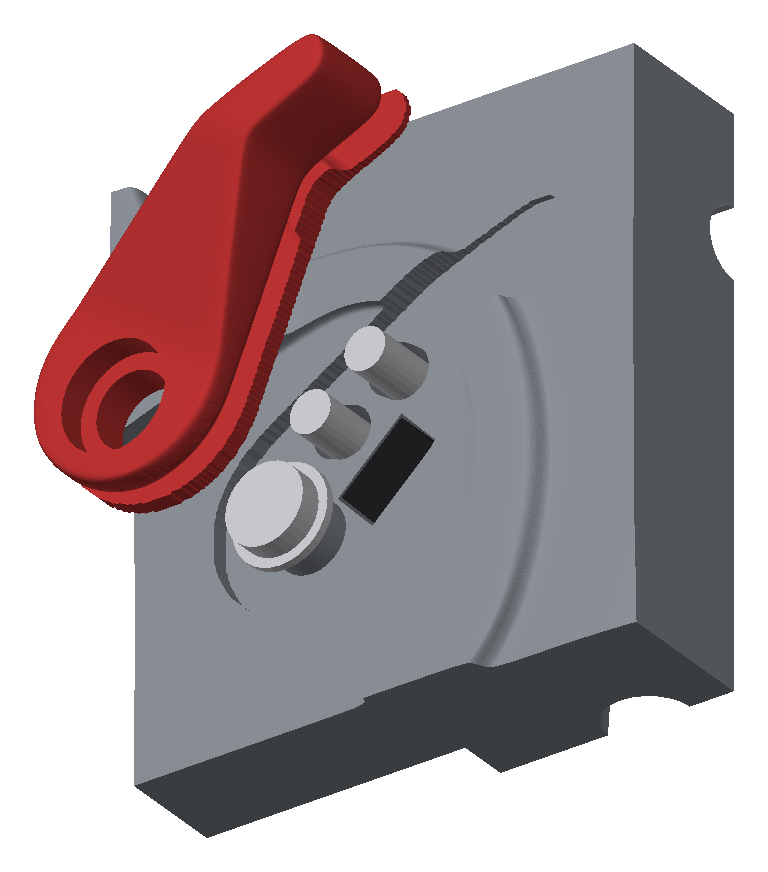

## Teile

Die Knoten in GLB/3MF tragen die Namen aus [`../mp5_umbau/`](../mp5_umbau/README.md#dateien)
(dort auch Datei und Herkunft im Originalsatz).

| Teil | Lage |
|---|---|
| Gehäuse links / rechts | Bezug (Teilungsebene Z = 0), 6 × M3 verschraubt |
| Zwischenring | vor dem Gehäuse, Profil und Stegkanal fluchtend |
| Handschutz hinten, Handschutz vorn mit Schalldämpfer links / rechts | vor dem Zwischenring, geteilt bei Y = −32; vorderer Teil links/rechts geteilt (Z = 0), 5 × M3 verschraubt, umschließt den Zapfen des hinteren Teils (4 × M3) |
| Linsenhülse, Frontkappe | vorn im bzw. auf dem Schalldämpfer |
| TSOP-Einsatz | vorn an der Rundung unter dem Korn, über dem Schalldämpfer |
| Steg vorn (Rundstab 96 mm) | Stahl; Gehäuse 34 mm, Zwischenring 21 mm, Handschutz hinten 41 mm (bis vor den Zapfen) |
| Korn | Ring auf dem Rohr vorn am Handschutz, Steg im Schlitz |
| Spannhebel Stift, Spannhebel Knauf | Stift im schrägen Loch der linken Mulde, Knauf außen darauf |
| Schaft links / rechts, OLED-Rahmen | an der Gehäuserückseite; Rahmen in der Stufe des OLED-Sockels; GX16-Buchse unten vorn (Y = 230, 15° nach hinten) |
| Steg hinten (Rundstab 77 mm) | Stahl; ab Anschlag Y = 164 bis in den Schaft |
| Magazin, Magazin Unterteil | voll im Magazinschacht, 12° geneigt |
| Abzug | auf der Achse X = 136 / Y = 129, Ruhelage |
| Nachladehebel | Sicherungshebel links über dem Griff, dreht um die Kreismarke (X = 121,17, Y = 158,09), Ruhelage |
| Platine | KiCad-Export (`kicad-cli pcb export glb`), Tasche in der rechten Hälfte; U4 als ESP32-S3-WROOM-1U (Modell aus `kicad/waffe_elektronik/scripts/gen_3d_wroom1u.py`) |
| Antennenbuchse RP-SMA, Antenne 2,4 GHz, Pigtail RP-SMA U.FL | Kaufteile, Geometrie in `platine_einbau.py`: Buchse quer durch die linke Wand (X = 71,5, Y = 134), Antenne nach oben geklappt, Pigtail als Schlaufe zum U.FL |

`obj_12_11` (Sechskantstift 6 × 17,6 mm) ist nicht enthalten: keine passende Aufnahme gefunden.

Überschneidungen in der Baugruppe (Prüfung mit manifold3d):
- Magazin ↔ Gehäuse 2 × 156 mm³: Mittelrippe hinten im Schacht (Z ±3,6) im Magazinrücken
- Korn ↔ Handschutz vorn links / rechts je ca. 138 mm³: Steg (9 × 12 mm) im Schlitz (6,7 × 8,1 mm), Klemmsitz
- Antennenbuchse, Antenne, Pigtail: 0 mm³
- Stege, Schaft, Platine, Spannhebel, Abzug, Linsenhülse, Frontkappe, Magazinunterteil, TSOP-Einsatz,
  OLED-Rahmen: ≤ 4 mm³

## Erzeugen

```sh
.venv/bin/pip install numpy trimesh manifold3d lxml networkx scipy shapely matplotlib
.venv/bin/python gehaeuse/scripts/umbau.py       # Druckteile nach mp5_umbau/
.venv/bin/python gehaeuse/scripts/baugruppe.py   # GLB/3MF
.venv/bin/python gehaeuse/scripts/kabelwege.py   # alle Kabelwege prüfen
.venv/bin/python gehaeuse/scripts/explosion.py gehaeuse/baugruppe/explosion_links.png -30 -22
.venv/bin/python gehaeuse/scripts/explosion.py gehaeuse/baugruppe/explosion_rechts.png 150 -22
.venv/bin/python gehaeuse/scripts/explosion.py gehaeuse/baugruppe/antenne_links.png 0 0 zusammen
.venv/bin/python gehaeuse/scripts/explosion.py gehaeuse/baugruppe/antenne_aussen.png -35 -20 zusammen
.venv/bin/python gehaeuse/scripts/explosion.py gehaeuse/baugruppe/antenne_innen.png -40 -30 zusammen \
    "ohne=Gehäuse links" "ohne=Nachladehebel" "ohne=Antenne 2,4 GHz" bereich=78,-130,122,-98
```
