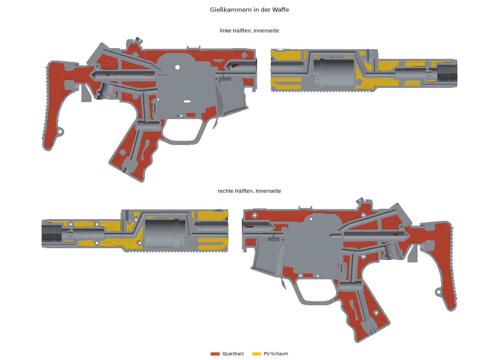
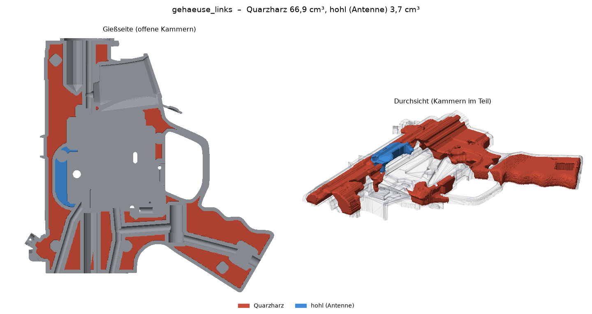
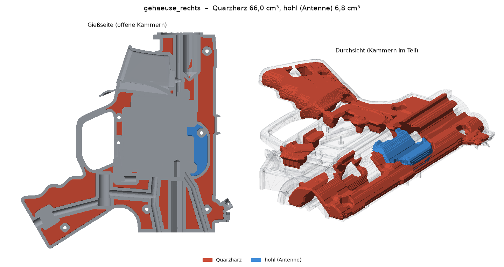
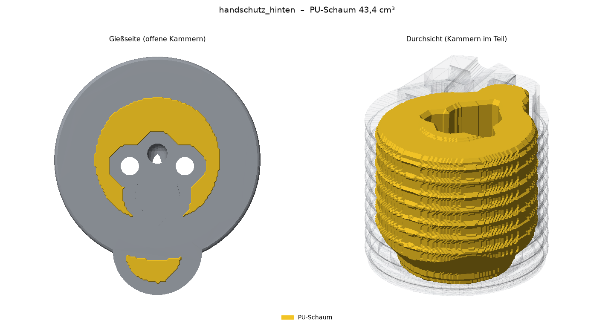
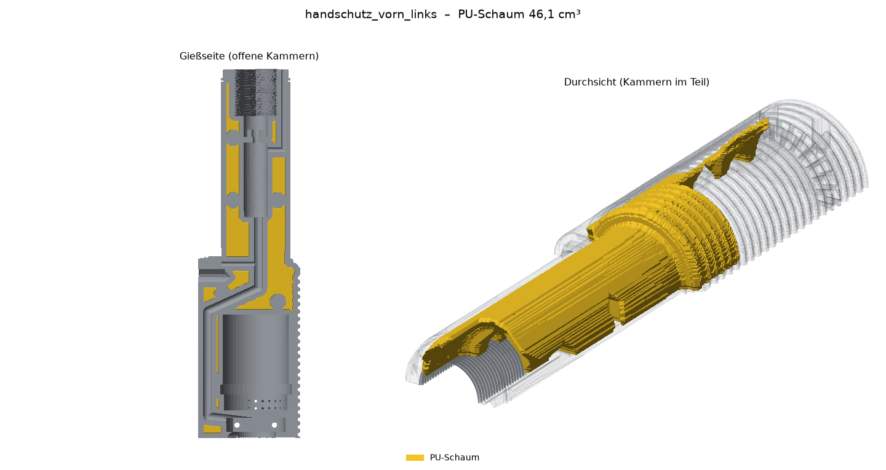
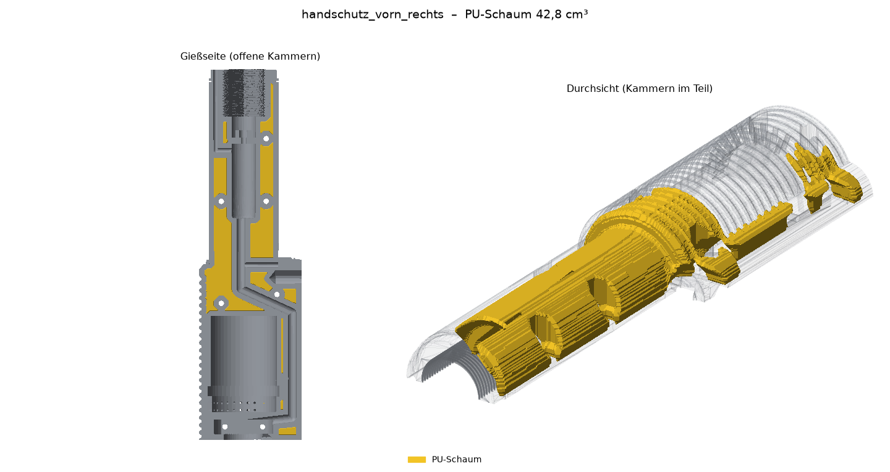
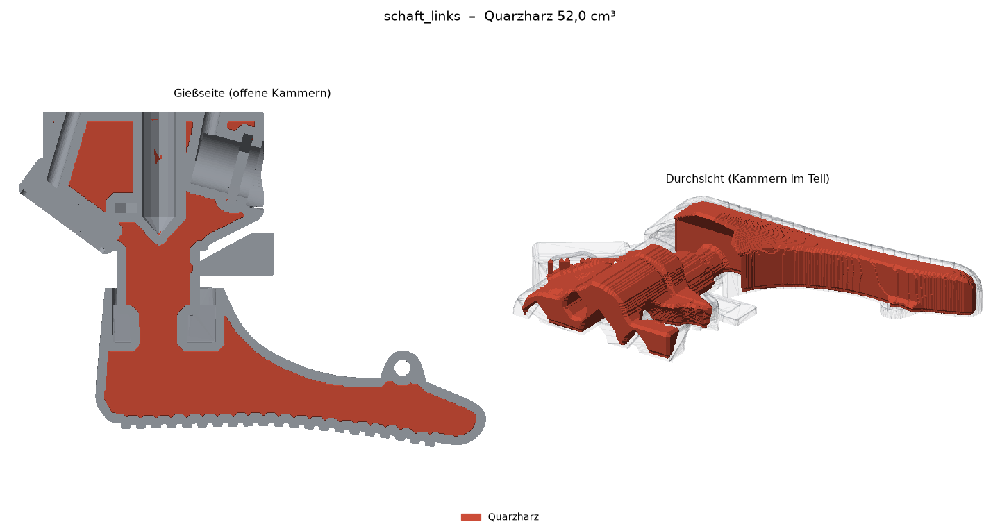
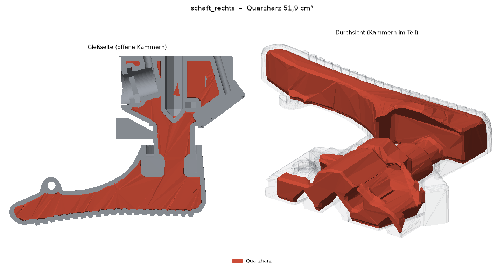

# MP5-Gehäuse mit Gießfüllung – Modifier für den Slicer

Variante B aus [GIESSFUELLUNG.md](../mp5_umbau/GIESSFUELLUNG.md): Die Teile selbst bleiben die aus
[`mp5_umbau/`](../mp5_umbau/). Hier liegen nur **Modifier-Volumen**, die im Slicer die Gießkammern erzeugen.

- **Prototyp ohne Füllung:** Teile aus `mp5_umbau/` wie gewohnt drucken (6 Wände, 50 % Gyroid), diesen Ordner
  ignorieren.
- **Gießvariante:** Teil + passende Modifier aus diesem Ordner zusammen laden (siehe unten).

Erzeugt mit `gehaeuse/scripts/giessfuellung.py` aus den STLs in `mp5_umbau/`. Nach jedem Lauf von `umbau.py`
das Skript neu laufen lassen (`python giessfuellung.py bilder` erzeugt nur die Bilder neu).

## Dateien

| Teil | Modifier | Kammer cm³ | Füllung g |
|---|---|---|---|
| `gehaeuse_links` | `__quarzharz` / `__hohl` (Antenne) | 66,9 / 3,7 | 127 / – |
| `gehaeuse_rechts` | `__quarzharz` / `__hohl` (Antenne) | 66,0 / 6,8 | 125 / – |
| `handschutz_hinten` | `__schaum` | 43,4 | 4 |
| `handschutz_vorn_links` | `__schaum` | 46,1 | 5 |
| `handschutz_vorn_rechts` | `__schaum` | 42,8 | 4 |
| `schaft_links` | `__quarzharz` (Ballast) | 52,0 | 99 |
| `schaft_rechts` | `__quarzharz` (Ballast) | 52,0 | 99 |

Zusammen ca. **237 cm³ Quarzharz (ca. 450 g)** und **132 cm³ Schaum (ca. 15 g)**. Werte in `volumen.json`
(Quarzharz 1,9 g/cm³, Schaum 0,1 g/cm³).

Nicht gefüllt (normal drucken): Zwischenring, Magazin, Magazin-Unterteil und alle Kleinteile.

## Wie die Kammern entstehen

- Kammer = alles im Teil mit **mindestens 2 mm Abstand zu jeder Oberfläche**. Dadurch bleiben gedruckt:
  Außenhaut, Auflagerand an der Teilungsfläche, Röhren um Schächte und Bohrungen, Dome um Einschmelzmuttern
  und Schraubensenkungen sowie Dämme an offenen Kabelnuten.
- **Offen nur zur Druckbett-Seite** (bei den Hälften die Teilungsfläche, beim hinteren Handschutz die
  Rückseite mit der Nut). Von dort ist jede Kammer über Flanken mit **höchstens 45° Überhang** erreichbar.
  Beim Gießen liegt die offene Seite oben, und die Luft steigt an solchen Decken von selbst heraus. Gedruckt
  sind 45° ohne Stütze möglich. Bereiche hinter steileren Überhängen bleiben gedruckt.
- **Gehäuse komplett Quarzharz**: Griff und Krafteinleitung (Einschmelzmuttern, Zuganker, Stege) ohne
  Trennwände dazwischen.
- **Hohl (Antenne):** 15 mm um den Antennenbereich des WROOM-1, mit 1,5 mm Trennwand zum Quarzharz. Wird
  geschlossen gedruckt und nicht gefüllt.
- Kammern unter 0,5 cm³ und dünne Grate (< ca. 1,6 mm) bleiben gedruckt. Quarzsand kommt dort ohnehin nicht hinein.
- Der **Zapfen des hinteren Handschutzes** (Einschmelzmuttern, Zuganker-Muttern) liegt beim Druck oben und
  ist von der offenen Seite aus nicht erreichbar. Er bleibt gedruckt. Im Slicer dort einen Modifier mit
  hohem Infill (≥ 60 %) setzen.
- Die Modifier reichen 0,8 mm unter das Bett, damit die Kammer ab der ersten Schicht sicher offen ist.

## Bambu Studio (X1, P1, A1)

Gilt genauso für OrcaSlicer. Die Einstellungsnamen stehen hier wie in der englischen Oberfläche, in Klammern
der Reiter. Bauraum 256 × 256 mm: Alle Teile passen, auf dem **A1 mini** (180 mm) passen Gehäusehälften und
vorderer Handschutz nicht.

### 1. Laden

1. *Datei → Importieren → 3D/STEP/3MF importieren* (Strg+I). Das Teil aus `mp5_umbau/` **und** seine Modifier
   aus diesem Ordner **gemeinsam** markieren, z. B. `schaft_links.stl` + `schaft_links__quarzharz.stl`.
2. Die Frage, ob die Dateien als **ein Objekt mit mehreren Teilen** geladen werden sollen, mit **Ja**
   beantworten. Nur so bleiben Teil und Modifier passend übereinander.
3. In der Objektliste links das Objekt aufklappen. Jeden Modifier per Rechtsklick → **Change type** → **Modifier**
   umstellen. Er wird dann durchsichtig dargestellt.
4. Prüfen, ob das Teil auf dem Bett liegt (die Modifier reichen 0,8 mm darunter, das ist gewollt). Liegt das Teil
   höher, Objekt markieren und im Reiter *Objekt* die Position Z auf 0 setzen.
5. Lage nicht drehen: Die Hälften liegen auf der Teilungsfläche, der hintere Handschutz auf der Seite mit der Nut.

### 2. Prozess für das Teil (global)

Basis: Systemprofil **0.20mm Standard @BBL** für deinen Drucker, Filament **Bambu PETG HF** (oder PETG Basic)
bzw. ASA, **Textured PEI Plate**.

| Einstellung | Wert |
|---|---|
| Layer height (*Quality*) | 0,20 mm. Für Handschutz und Schaft optional *Variable layer height* (Symbol rechts, „Adaptive“) |
| Line width: Outer wall / Inner wall / Sparse infill (*Quality*) | 0,42 / 0,50 / 0,50 mm |
| Wall generator (*Quality*) | Arachne |
| Seam position (*Quality*) | Aligned (oder Back) |
| Wall loops (*Strength*) | **2** |
| Top shell layers / Top shell thickness (*Strength*) | 5 / 1,0 mm |
| Bottom shell layers / Bottom shell thickness (*Strength*) | 4 / 0 mm |
| Sparse infill density / pattern (*Strength*) | **30 %** / **Gyroid** |
| Infill combination (*Strength → Advanced*) | an |
| Ironing (*Quality*) | aus |
| Support (*Support*) | wie beim massiven Druck: an, Type *tree(auto)* |
| Speed | Systemprofil. Für eine feinere Außenseite *Outer wall* auf 120 mm/s |

### 3. Prozess für die Modifier

Modifier in der Objektliste markieren, Rechtsklick → **Add settings** (bzw. das Zahnrad am Modifier), dann
die Werte setzen. Nur diese Werte überschreiben, alles andere erbt der Modifier vom Teil.

| Einstellung | `__quarzharz`, `__schaum` | `__hohl` |
|---|---|---|
| Bottom shell layers | **0** | (nicht ändern, 4) |
| Bottom shell thickness | **0** | (nicht ändern) |
| Sparse infill pattern | **Lightning** | Lightning |
| Sparse infill density | 15 % | 15 % |

- **Bottom shell thickness muss 0 sein.** Sonst ergänzt Bambu Studio Bodenschichten bis zur Mindestdicke, und die
  Kammer ist unten geschlossen.
- Top shell layers bleiben bei 5: Das ist die Außenhaut über der Kammer.
- **Nur beim hinteren Handschutz:** Rechtsklick auf das Objekt → *Add modifier* → *Box*. Den Quader über den
  Zapfen legen (oberste ca. 20 mm des Teils) und darin *Sparse infill density* auf **60 %** setzen. Dort sitzen
  Einschmelzmuttern und Zuganker-Muttern, die Stelle bleibt gedruckt.

### 4. Vorschau prüfen (nach *Slice plate*)

- **Schicht 1–3:** Im Bereich der Kammern liegen nur einzelne Lightning-Stränge, keine geschlossene Fläche.
  Rundherum der Rand, um Bohrungen und Schächte geschlossene Ringe.
- **Kammerdecke:** Mit dem Schichtregler bis zur Oberkante der Kammern gehen. Darüber folgen die 5
  Deckschichten. Wenn die erste Deckschicht weit frei überbrückt, im Modifier *Sparse infill pattern* auf
  **Gyroid 10 %** stellen. Das wird ebenfalls eingegossen.
- Die Druckzeit oben rechts mit dem massiven Druck vergleichen. Erwartet wird etwa die Hälfte (moderner
  Drucker: Gehäusehälfte ca. 2,5 h statt 5 h, Schafthälfte ca. 1 h statt 2 h).

### 5. Speichern

Das fertige Objekt als Projekt speichern (*Datei → Projekt speichern unter*, `.3mf`). Dann bleiben Modifier und
Einstellungen für die nächste Waffe erhalten. Mehrere gleiche Teile auf einer Platte: Objekt kopieren
(Strg+C / Strg+V), die Modifier werden mitkopiert.

## Gießen

Ablauf in GIESSFUELLUNG.md, Abschnitt 6. Teil mit der offenen Seite nach oben legen (wie links in den
Bildern). Zuerst die Quarzharz-Zonen füllen, nach dem Aushärten den Schaum. Jeweils nur bis 0,5–1 mm unter
die Teilungsfläche bzw. Auflagefläche füllen.

## Vorschau je Teil

Links die Gießseite (Teil umgedreht, Kammern offen nach oben), rechts die Durchsicht mit den Kammern im Teil.

### Gehäuse links

### Gehäuse rechts

### Handschutz hinten

### Handschutz vorn links

### Handschutz vorn rechts

### Schaft links

### Schaft rechts

