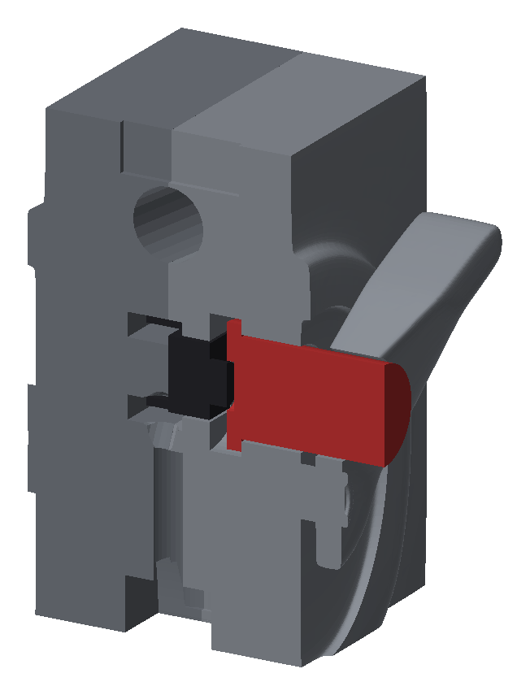

# MP5-Umbau für die Lasertag-Elektronik

Geänderte Druckteile und neue Teile, erzeugt mit [`../scripts/umbau.py`](../scripts/umbau.py).
Geänderte Originalteile liegen in derselben Drucklage wie die Originale, neue Teile druckfertig
(flach bzw. stehend). Zusammengesetzt: [`../baugruppe/`](../baugruppe/).

## Dateien

Vollständiger Drucksatz, jedes Teil mit eindeutigem Namen (gleicher Name als Knoten in der Baugruppe).

| Datei | Teil | aus Original | Änderung |
|---|---|---|---|
| `gehaeuse_links.stl` | Gehäuse links | `obj_1_3` | Platinentasche (Bauteilseite) mit Zonen für die Stecker, USB-C bündig in einer Mulde, Abzugsmechanik, Kabelschächte (auch zur Westenbuchse), Motor, Drehgeber, Nachladetaste, Einschmelzmuttern |
| `gehaeuse_rechts.stl` | Gehäuse rechts | `obj_3_6` | Platinentasche mit Domen, Abzugsmechanik, Kabelschächte (auch zur Westenbuchse), Motor, Drehgeber, Auflage der Nachladetaste, Schraubensenkungen |
| `zwischenring.stl` | Zwischenring | `obj_5_5` | Kabelschacht |
| `handschutz_hinten.stl` | Handschutz hinten | `obj_10_2` | einteilig, ab Y = −32; vorn Zapfen mit 4 Einschmelzmuttern, Kabelschacht |
| `handschutz_vorn_links.stl` | Handschutz vorn mit Schalldämpfer links | `obj_10_2` | links/rechts geteilt (flach auf der Teilungsfläche), Einschmelzmuttern; Aufnahme für den Zapfen, Lautsprechertasche, Schallkammer mit Löchern, Basskammer, Kabelnut, TSOP-Aufnahme, Gewinde M24 × 1,5, LED-Sitz, Kabelkanäle, Zapfen für die Frontkappe |
| `handschutz_vorn_rechts.stl` | Handschutz vorn mit Schalldämpfer rechts | `obj_10_2` | Gegenstück, Schraubensenkungen (auch für den Zapfen) |
| `frontkappe.stl` | Frontkappe | neu | 12 Fenster für das Ringlicht (Front unten drucken) |
| `linsenhuelse.stl` | Linsenhülse | neu | Gewinde M24 × 1,5 für die Linse Ø 20 |
| `tsop_einsatz.stl` | TSOP-Einsatz | neu | Halter für den TSOP34838 mit Linsenfenster (Fensterseite oben drucken) |
| `korn.stl` | Korn | `obj_7_1` | unverändert |
| `spannhebel_stift.stl` | Spannhebel Stift | `obj_11_12` | unverändert |
| `spannhebel_knauf.stl` | Spannhebel Knauf | `obj_9_10` | unverändert |
| `schaft_links.stl` | Schaft links | `obj_4_7` | OLED-Sockel, Kabelschacht, Aufnahme der GX16-Buchse (Weste) |
| `schaft_rechts.stl` | Schaft rechts | `obj_2_4` | OLED-Sockel, Kabelschacht, Aufnahme der GX16-Buchse (Weste) |
| `oled_rahmen.stl` | OLED-Rahmen | neu | Fenster 24 × 14 mit Fase (Außenseite oben drucken) |
| `steg_vorn_96mm.stl` | Steg vorn (Rundstab 96 mm) | `obj_8_8` | auf 96 mm gekürzt (endet vor dem Zapfen) |
| `steg_hinten_77mm.stl` | Steg hinten (Rundstab 77 mm) | `obj_8_8` | auf 77 mm gekürzt |
| `magazin.stl` | Magazin | `obj_6_9` | Akkuhalter (3 Rippen), unteres Drittel abgetrennt, Öffnung oben |
| `magazin_unterteil.stl` | Magazin Unterteil | `obj_6_9` | abnehmbar, Zapfen stützt den Akku |
| `abzug.stl` | Abzug | `obj_1_3`/`obj_3_6` | aus dem Gehäuse gelöst, Nabe und Hebel (flach drucken) |
| `nachladetaste.stl` | Nachladetaste | neu | Kappe mit Bund für den Taster 6 × 6 (Bund unten drucken) |
| `lage.json` | – | – | Lage der neuen Teile in der Waffe (für `baugruppe.py`) |

`obj_12_11` (Sechskantstift 6 × 17,6 mm) aus dem Originalsatz hat keine erkennbare Aufnahme und ist nicht enthalten.

## Kaufteile

| Teil | Typ |
|---|---|
| Achse Abzug | Stahlstift Ø 3 × 25 mm |
| Abzugsfeder | Druckfeder Ø 5 × 15 mm, Draht 0,5–0,6 mm (härter/weicher tauschbar) |
| Abzugsschalter | Omron D2F-01 (Stößel unten, Grundfläche oben) |
| Linse | Ø 20 mm, bis 7 mm dick, in die Hülse geklebt |
| IR-LED | 5 mm (z. B. TSAL6100), von vorn in den Sitz gesteckt |
| Ringlicht | 12 × WS2812/SK6812, Ø 36,8/23,3 mm (Adafruit #1643 o. ä.) |
| Akku | 1 × 18650 mit Kabel und JST-PH-2-Stecker |
| OLED | 0,96″ SSD1306 I²C 128 × 64 (Platine 27,3 × 27,8), Kabel direkt angelötet, ohne Stiftleiste |
| Drehgeber | EC11 mit Taster, Welle Ø 6, 20 mm |
| Vibrationsmotor | Ø 10 × 20 mm mit Unwucht |
| Nachladetaste | Taster 6 × 6 × 5 mm THT (Stößel rund Ø 3,5, Höhe bis Stößel 5,0) |
| Platine | M2 × 8 ISO 7380 (2 ×) |
| Gehäusehälften | 6 × M3 × 10 ISO 4762, 6 × Einschmelzmutter M3 × 5,7 (Loch Ø 4,0) |
| Handschutz vorn | 5 × M3 × 10 ISO 4762, 5 × Einschmelzmutter M3 × 5,7 (Loch Ø 4,0) |
| Handschutz vorn ↔ hinten | 4 × M3 × 10 ISO 4762, 4 × Einschmelzmutter M3 × 5,7 (in den Zapfen) |
| Lautsprecher | Ø 40 mm, 4–8 Ω, 2–3 W, bis 6 mm Einbautiefe |
| Sensorkabel Weste | GX16-7 Einbaubuchse (Gewinde M16 × 1, Mutter SW 19, Flansch bis Ø 20) + GX16-7 Kabelstecker; 7 Litzen AWG 28 zu J2 (JST-SH 7) |
| Kabel innen | Litze AWG 28 (Ø ≤ 0,9 mm), Akku AWG 24 (Ø ≤ 1,3 mm) |
| TSOP 6 | TSOP34838 (6 × 6,95 × 5,6 mm) |

## Einbau

- **Platine** in der rechten Hälfte, Oberkante X = 76 (4 mm höher als zuvor, Platz für den Abzug)
- **USB-C** (Buchse 10,5 mm hoch) reicht durch die linke Seitenwand (Durchbruch 9,3 × 3,5) und schließt bündig
  mit einer flachen Mulde (14 × 8,5, Boden auf Höhe der Buchsenoberkante) ab

- **Abzug:** Achse X = 136 / Y = 129, Stift durch beide Hälften; Hebel nach hinten unter
  Mikroschalter und Feder; Schalter löst bei ca. 4,5° aus, Anschlag bei 5° (Abzugsweg vorn ca. 3 mm)
- **Schalldämpfer:** Linsenhülse von vorn einschrauben und mit Werkzeug in den Schlitzen verstellen
  (LED-Abstand 13–26 mm, nominal 21 mm); ganz heraus nur bei abgenommener Frontkappe.
  LED von vorn in den Sitz stecken, Kabel nach hinten
- **Ringlicht** von hinten in die Frontkappe legen, Kabel durch den Kanal unten im Schalldämpfer;
  Frontkappe auf den Zapfen stecken
- **Kabelschacht** Ø 5 von der Mündung durch Handschutz, Zwischenring und Gehäuse bis zur Platine;
  Abzweig Ø 6 in den Magazinschacht (Akkukabel)
- **Magazin:** geteilt direkt unter dem Akku (der starre 18650 passt nicht durch den gebogenen
  unteren Teil); Akku von dort gerade einschieben, Unterteil aufstecken. Kabel mit JST-PH-Stecker
  oben heraus; vor dem Einsetzen mit dem Kabel aus dem Schacht verbinden, Stecker in den oberen
  Magazinraum schieben. Der Akku sitzt mit nur ca. 0,5 mm Luft – Zelle ohne dicken Schrumpfschlauch
- **OLED** angewinkelt in der Schrägfläche vorn oben am Schaft: abgerundeter Sockel, Modul von oben
  einkleben (Glas liegt unter der Rahmenstufe), Rahmen in die Stufe setzen; Kabel (Stiftleiste nicht
  bestücken) durch den Schacht im Schaft und Gehäuse zur Platine (OLED). Kimme und Korn bleiben
- **Drehgeber** hinten in der schrägen Griffunterseite, Achse entlang des Griffs, Buchse bündig,
  Welle schaut heraus (Kappe aufstecken)
- **Vibrationsmotor** über dem Griff, Unwucht hinten; Kabel mit dem Drehgeberkabel zur Platine (VIB)
- **Gehäusehälften** verschraubt: Einschmelzmuttern von der Teilungsebene in die linke Hälfte,
  Schrauben M3 × 10 von rechts (Kopf versenkt); vorn oben, Mitte oben, hinten oben, vor dem Abzug,
  hinten über dem Griff, unten im Griff
- **Handschutz vorn mit Schalldämpfer** links/rechts geteilt (Z = 0), beide Hälften flach drucken:
  Einschmelzmuttern in die linke Hälfte, Schrauben M3 × 10 von rechts (Kopf versenkt); 2 Schrauben
  direkt vor der Basskammer, 3 am Schalldämpfer. Lautsprecher, LED, TSOP-Einsatz und Kabel vor dem Verschrauben einlegen
- **Handschutz vorn ↔ hinten:** der hintere Handschutz (einteilig) hat vorn einen Zapfen (Hals Ø 22, Kopf Ø 33
  mit zwei Flächen); die vorderen Hälften umschließen ihn formschlüssig (zieht nicht ab, verdreht nicht).
  4 Einschmelzmuttern seitlich in die Flächen des Kopfs, jede Hälfte mit 2 × M3 × 10 von außen
  (Kopf versenkt) daran schrauben, dann die Hälften miteinander verschrauben. Kein Kleber, alles lösbar
- **Lautsprecher** Ø 40 im vorderen Handschutz: in die Tasche einer Hälfte legen (Membran nach hinten zur
  Schallkammer), Kabel durch die kleine Bohrung in die Kabelnut und abdichten (Basskammer ca. 42 cm³
  bleibt geschlossen). Der Schall geht durch 2 Reihen Löcher Ø 1,8 in den Rillen zwischen den Rippen
- **TSOP 6** vorn an der Rundung unter dem Korn, über dem Schalldämpfer, Linse nach vorn: TSOP von
  hinten in den Einsatz schieben, Kabel an die Beinchen (zeigen nach unten), Einsatz in die Aufnahme
  stecken; Kabel senkrecht nach unten in den Hauptschacht
- **Kabelschächte** laufen als gerade Stücke in beliebiger Richtung (auch diagonal), z. B. vom OLED
  schräg durch das Gehäuse und im Handschutz oben im Rohr um den Lautsprecher herum. Dieses Stück liegt
  als offene Nut an der Teilungsfläche der rechten Hälfte: Kabel einlegen, dann durch die Bohrung im
  Zapfen in den hinteren Handschutz
- **Weste:** GX16-7 Buchse unten vorn am Schaft, 15° schräg nach hinten unten; der Stecker hängt hinter dem
  Griff (ca. 35 mm Abstand zur Griffrückseite, 40 mm vor der Schaftkappe), weg von Schießhand und Wange.
  Mutter vor dem Zusammensetzen der Schafthälften in die Sechskanttasche legen, Buchse später von außen
  eindrehen (Flansch auf der Planfläche). Litzen an die Lötkelche, durch den Schacht schräg nach vorn
  in den Motorschacht (Ø 6, gemeinsam mit Motor und Drehgeber), in die VIB-Zone und flach unter der
  Platine zu J2. Belegung: [Sensorkabel](../../readme.md#3-sensorkabel-zwischen-weste-und-waffe)

- **Nachladetaste** links über dem Griff am oberen Rand des Sicherungshebel-Knopfs (Daumen der Schießhand):
  Kappe von innen in das Loch der linken Hälfte stecken (Bund innen), Taster 6 × 6 mit dem Stößel auf die
  Kappe setzen, Beinchen nach unten in die zwei Schlitze der rechten Hälfte biegen, Litzen anlöten und in die
  Nut an der Teilung zur Tasche des Abzugsschalters legen, von dort wie das Abzugskabel zu SW2. Beim
  Verschrauben der Hälften liegt der Taster auf der rechten Hälfte, die Kappe ist gefangen (0,8 mm Überstand)

## Kabelwege

Geprüft mit [`../scripts/kabelwege.py`](../scripts/kabelwege.py): jede Leitung vom Stecker auf der Platine
bis zum Bauteil, das Kabelbündel als Zylinder gegen alle Teile der Baugruppe (Platine eingeschlossen).
Alle Wege sind frei. Jeder Stecker der Platine zeigt in die Zone am Platinenrand, aus der sein Schacht
abgeht: links (vorn) in den Hauptschacht, unten in den Kanal zum Abzugsschalter, rechts (hinten) in den
Motorschacht, rechts oben in OLED- und Motorschacht.

| Leitung | Stecker | Adern | Weg | Länge ca. |
|---|---|---|---|---|
| Akku | BT1 (JST-PH 2) | 2 × AWG 24 | linke Zone → Hauptschacht → Abzweig in den Magazinschacht → JST-PH im Magazin | 35 mm + Stecker |
| IR-LED | LED1 (JST-SH 2) | 2 | linke Zone → Hauptschacht → Zwischenring → Handschutz (um den Lautsprecher) → LED-Sitz | 345 mm |
| TSOP 6 | J6 (JST-SH 3) | 3 | wie IR-LED bis Y −129, senkrecht hoch in den TSOP-Einsatz | 305 mm |
| Ringlicht | J1 (JST-PH 3) | 3 | linke Zone → Hauptschacht → Bohrung → Kanal unten im Schalldämpfer → Frontkappe | 410 mm |
| Lautsprecher | SP1 (JST-PH 2) | 2 | linke Zone → Hauptschacht → Kabelnut → Bohrung in die Basskammer | 305 mm |
| Abzug | SW1 (JST-SH 2) | 2 | untere Zone → Schaltertasche | 50 mm |
| Nachladen | SW2 (JST-SH 2) | 2 | untere Zone → Schaltertasche → Nut an der Teilung → Taster | 60 mm |
| Weste | J2 (JST-SH 7) | 7 | rechte Zone → Motorschacht → Westenschacht → GX16-Buchse | 90 mm |
| OLED | J4 (JST-SH 4) | 4 | Zone rechts oben → OLED-Schacht → OLED im Schaft | 95 mm |
| Drehgeber | J5 (JST-SH 4) | 4 | Zone rechts oben → VIB-Zone → Motorschacht → Motorraum → Drehgeber | 145 mm |
| Vibrationsmotor | M1 (JST-SH 2) | 2 | rechte Zone → Motorschacht → Motor | 80 mm |

Füllung der Schächte (Querschnitt der Adern / Schacht): Hauptschacht im Gehäuse 46 % (12 Adern inkl. Akku,
dünne Silikonlitze verwenden), im Handschutz 32 %, Motorschacht 29 % (Motor, Drehgeber, Weste: 13 Adern),
Westenschacht 23 %, OLED-Schacht 16 %. Längen ohne Zugabe; je Leitung ca. 30 mm Reserve lassen.
