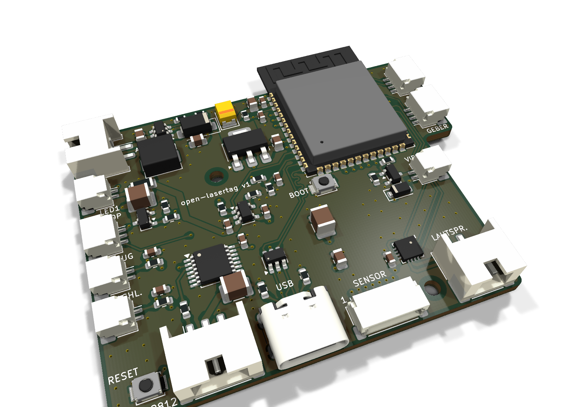
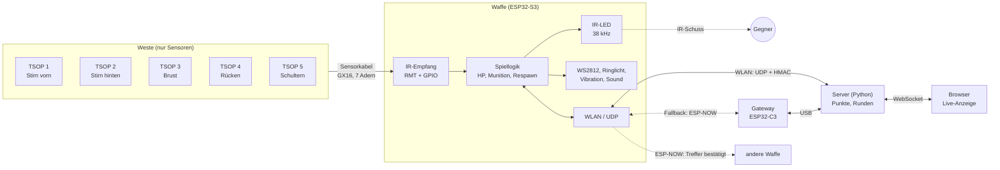
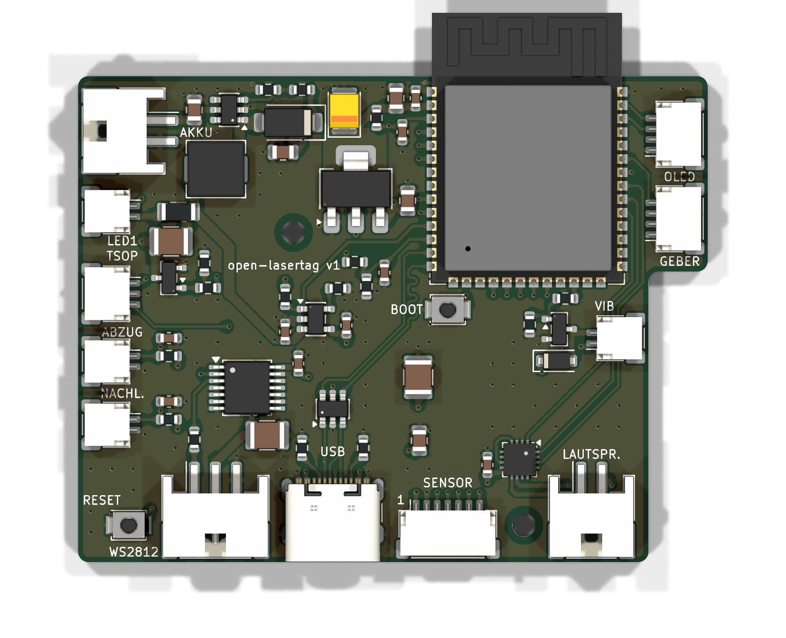
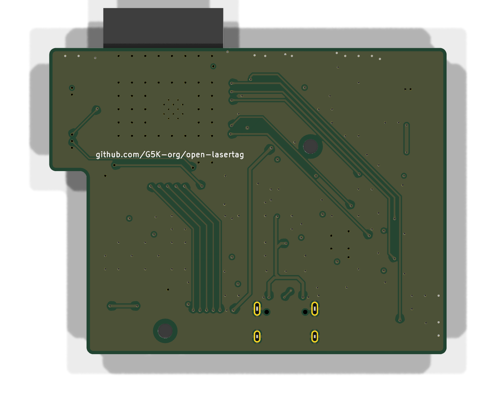
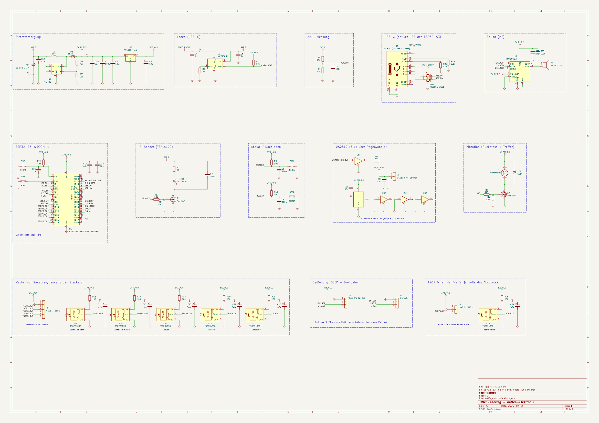
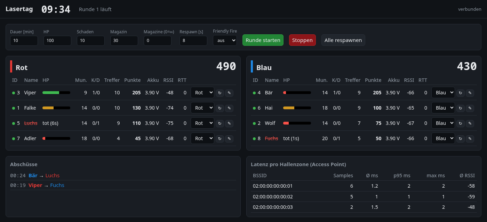

<div align="center">

# Open Lasertag

**Infrarot-Lasertag zum Selberbauen – ESP32-S3 in der Waffe, passive Sensorweste, Spielserver in Python**




</div>

## Was ist das?

Ein komplettes Lasertag-System im Eigenbau für Spiele in einer großen Halle:

- **Waffe:** ein 3D-gedrucktes MP5-Gehäuse mit einer eigenen Platine. Darauf
  sitzt ein ESP32-S3, der alles steuert: IR-Schuss, Trefferauswertung,
  Lebens- und Munitionsanzeige, Mündungsfeuer, Vibration, Sound, Akku und WLAN.
- **Weste:** nur passive IR-Empfänger (TSOP34838) an Stirnband, Brust, Rücken
  und Schultern, per Kabel an der Waffe. Die Weste hat keine eigene Elektronik.
- **Server:** ein Python-Programm mit Live-Anzeige im Browser. Es zählt
  Punkte, führt Runden und gibt den Respawn frei.
- **Gateway (optional):** ein kleiner ESP32 am Server-PC. Über ihn erreichen
  die Waffen den Server per ESP-NOW, wenn das WLAN ausfällt.

Geschossen wird mit einer 940-nm-IR-LED hinter einer Linse, nicht mit einem
echten Laser. Die Spiellogik läuft lokal in der Waffe, damit Treffer sofort
Licht, Ton und Vibration auslösen. Das Netz meldet nur nach.

## Inhalt

- [Funktionen](#funktionen)
- [Systemüberblick](#systemüberblick)
- [Hardware](#hardware)
- [Gehäuse](#gehäuse)
- [Firmware](#firmware)
- [Server und Live-Anzeige](#server-und-live-anzeige)
- [Schnellstart](#schnellstart)
- [Projektstruktur](#projektstruktur)
- [Stand](#stand)
- [Planung im Detail](#planung-im-detail)
  1. [Grundentscheidungen](#1-grundentscheidungen)
  2. [Architektur](#2-architektur)
  3. [Sensorkabel zwischen Weste und Waffe](#3-sensorkabel-zwischen-weste-und-waffe)
  4. [IR-Protokoll und Trefferlogik](#4-ir-protokoll-und-trefferlogik)
  5. [Netzwerk](#5-netzwerk)
  6. [Anzeige und Feedback](#6-anzeige-und-feedback)
  7. [Risiken und Gegenmaßnahmen](#7-risiken-und-gegenmaßnahmen)
  8. [ESP32-Wahl](#8-esp32-wahl)
  9. [Vorgehen](#9-vorgehen)
  10. [Offene Punkte](#10-offene-punkte)

## Funktionen

| | |
|---|---|
| 🔫 **Schuss** | NEC-codiertes IR-Signal (Team + Spieler-ID), 38 kHz, jeder Schuss 2× gesendet; Ziel 30–50 m Reichweite |
| 🎯 **Treffer** | bis zu 6 Sensoren; Treffer zählt erst bei 2 gültigen Frames in 100 ms, danach 500 ms unverwundbar; Kopftreffer geben Bonuspunkte |
| 💡 **Anzeige** | WS2812-Kette an der Waffe: Lebensbalken grün → gelb → rot, Munition, Teamfarbe, Ringlicht als Mündungsfeuer; Anschlüsse für OLED (I²C) und Drehdrück-Geber |
| 📳 **Feedback** | Rückstoß- und Treffervibration, Soundeffekte über I²S-Verstärker, weißer Blitz bei Treffer, rotes Pulsieren als tot |
| 🔋 **Akku** | 1S-LiPo, Laden über USB-C, Spannungs- und Ladeanzeige |
| 📡 **Netz** | WLAN mit eigenem Roaming zwischen Access Points, UDP mit HMAC-Signatur, Treffer werden bis zur Bestätigung wiederholt |
| 🛟 **ESP-NOW** | Fallback zum Server über ein Gateway, wenn das WLAN ausfällt; Trefferbestätigung direkt an die Waffe des Schützen (Ton + grüner Blitz) |
| 🖥️ **Server** | Runden mit Zeitlimit, Teamwertung, Respawn-Freigabe, Live-Anzeige und Bedienung im Browser, Latenzmessung pro Hallenzone |

## Systemüberblick



## Hardware

Eine Platine für die ganze Waffe: 59,6 × 46 mm (L-förmig), 4 Lagen, nur SMD-Bauteile, von
Hand geroutet und für die Bestückung bei JLCPCB vorbereitet. Alle Peripherie
hängt an Steckern: Akku, IR-LED, Taster, Motoren, Lautsprecher, WS2812, ein Sensor an der Waffe und
das Sensorkabel der Weste.

| Oberseite | Unterseite |
|---|---|
|  |  |

**Auf der Platine:** ESP32-S3-WROOM-1 (16 MB Flash, 8 MB PSRAM), USB-C mit
ESD-Schutz zum Flashen und Laden, Lader MCP73831, 5-V-Boost MT3608,
3,3-V-Regler, MOSFETs für IR-LED und Vibrationsmotor, Pegelwandler für
WS2812, I²S-Verstärker MAX98357A, GX16-Buchse für das Sensorkabel der Weste.

<a href="kicad/waffe_elektronik/renders/schaltplan.png"></a>

Schaltplan, Layout, Fertigungsdaten und Design-Entscheidungen:
[kicad/waffe_elektronik/](kicad/waffe_elektronik/) · Pinbelegung:
[pinbelegung.md](pinbelegung.md)

## Gehäuse

Als Basis dient das Modell
[MP5 Toygun Cosplay](https://makerworld.com/de/models/427808-mp5-toygun-cosplay)
von **WIZZY** (MakerWorld). Es ist eine rein statische Requisite und wird für
Platine, Akku, Lautsprecher und Optik ausgehöhlt und angepasst. Vorne an der
Mündung sitzt ein WS2812-Ring als Mündungsfeuer.

| | | |
|---|---|---|
|  |  |  |

<sub>Bilder und STL-Dateien: WIZZY, MakerWorld, unter der MakerWorld
Standard-Digitaldatei-Lizenz. Details in
[gehaeuse/mp5_toygun_stls/](gehaeuse/mp5_toygun_stls/).</sub>

## Firmware

ESP-IDF v6.0, nur offizielle Espressif-Komponenten. WLAN und Netz laufen auf
Core 0, IR-Empfang und Spiellogik auf Core 1.

- **IR:** Senden über RMT mit 38-kHz-Träger. TSOP 1–4 laufen über die vier
  RMT-Empfangskanäle, weitere Sensoren über GPIO-Interrupts. Beide Wege gehen
  in denselben NEC-Decoder.
- **Feedback:** WS2812 über `led_strip`, Vibration per PWM, Soundeffekte
  werden synthetisch erzeugt (keine Sound-Dateien).
- **Netz:** kein Stromsparmodus, eigenes Roaming unter −75 dBm, Treffer
  werden gepuffert und wiederholt, bis der Server bestätigt.
- **ESP-NOW:** ohne WLAN nach 5 s Fallback über das [Gateway](gateway/);
  getroffene Waffen bestätigen dem Schützen den Treffer direkt.
- **Einstellungen:** Team, Spieler-ID, WLAN, Server und Spielregeln unter
  `idf.py menuconfig`. Team und ID kann auch der Server setzen.

Details: [firmware/](firmware/)

## Server und Live-Anzeige



Reines Python (Standardbibliothek, keine Installation). Der Server nimmt die
UDP-Pakete der Waffen an, wertet Treffer und Abschüsse aus, führt Runden mit
Zeitlimit und gibt den Respawn frei. Im Browser gibt es Teamwertung,
Spielerwerte (HP, Munition, K/D, Akku, Signal, Latenz), Abschussliste und die
Latenz pro Access Point. Ein Waffen-Simulator erlaubt Tests ohne Hardware.

Details: [server/](server/) · ESP-NOW-Gateway: [gateway/](gateway/)

## Schnellstart

**Firmware bauen und flashen** (Platine über USB-C anschließen):

```sh
. ~/esp/esp-idf-v6.0.3/export.sh
cd firmware
idf.py menuconfig          # "Lasertag Waffe": WLAN, Server-IP, Team, Spieler
idf.py -p /dev/ttyACM0 flash monitor
```

**Server starten:**

```sh
cd server
cp config.example.json config.json   # Schlüssel wie in der Firmware eintragen
python3 -m lasertag_server --config config.json
# Live-Anzeige: http://<server-ip>:8080/
```

**Ohne Hardware ausprobieren:**

```sh
cd server
python3 -m lasertag_server &
python3 sim_weapon.py --count 6
```

## Projektstruktur

```
├── firmware/              ESP-IDF-Projekt der Waffe
│   ├── main/              Module: IR, Spiellogik, LEDs, Sound, Netz, …
│   ├── test/              Host-Test des NEC-Decoders
│   └── tools/             kleiner UDP-Testserver
├── gateway/               ESP-NOW-Gateway (ESP32-C3) für den Server
├── server/                Spielserver in Python
│   ├── lasertag_server/   UDP, Spiellogik, Web/WebSocket, Oberfläche
│   ├── sim_weapon.py      Waffen-Simulator
│   └── tests/             Unit-Tests
├── kicad/waffe_elektronik/
│   ├── scripts/           Generatoren für Schaltplan und Platine
│   ├── renders/           Bilder von Platine und Schaltplan
│   └── fertigung/jlcpcb/  Gerber, BOM, CPL
├── gehaeuse/              MP5-Gehäusebasis (STL)
├── docs/bilder/           Screenshots
├── pinbelegung.md         GPIO-Belegung des ESP32-S3
└── roadmap.md             Phasenplan
```

## Stand

| Teil | Stand |
|---|---|
| Schaltplan und Platine | fertig, ERC/DRC ohne Fehler, Bestellpaket für JLCPCB erstellt |
| Firmware | erste Fassung, auf einem ESP32-S3 geflasht und gestartet; Peripherie noch nicht getestet |
| Server | erste Fassung, mit simulierten Waffen getestet |
| ESP-NOW | Fallback Waffe ↔ Gateway ↔ Server mit zwei ESP32-S3 getestet (beide Richtungen, RTT ~22 ms); Trefferbestätigung Waffe zu Waffe noch ungetestet |
| Gehäuse | Basismodell ausgewählt, Umbau für die Elektronik offen |
| Weste | Sensoren und Kabel geplant |

Nächste Schritte im [Phasenplan](roadmap.md).

---

# Planung im Detail

Stand der Planung: 08.10.2026

## 1. Grundentscheidungen

| Thema | Entscheidung |
|---|---|
| Strahl | IR-LED 940 nm + Linse, kein echter Laser |
| Empfänger | TSOP34838 (Tageslichtfilter) |
| Aufteilung | Ein ESP32-S3 in der Waffe, Weste trägt nur noch passive TSOP-Sensoren |
| Verbindung Weste–Waffe | reines Sensorkabel (3,3 V + GND + je 1 Ader pro TSOP) |
| Netz | WLAN + UDP zu einem Server |
| Spiellogik | lokal in der Waffe (HP, Vibration, LEDs, Sound), Netz meldet nur nach |
| ESP-NOW | Fallback zum Server über ein Gateway und Trefferbestätigung Waffe zu Waffe, WLAN bleibt der Hauptweg |
| Firmware-Framework | ESP-IDF, kein Arduino – nur offizielle Espressif-Komponenten (RMT, I²S, led_strip, esp_wifi) |

---

## 2. Architektur

Übersichtsdiagramm siehe [Systemüberblick](#systemüberblick).

### Waffe (ESP32-S3, zentrale Elektronik – einziger Chip)
- IR-LED (TSAL6100 o. ä.) über N-MOSFET (AO3400 / IRLZ44N), Gate 100 Ω, Pulldown 100 kΩ
- 100–220 µF Elko direkt am MOSFET
- Abzug und Nachladen (Mikrotaster, RC-Entprellung 10 kΩ + 100 nF)
- Munitionszähler: WS2812-Kette, dazu kleines OLED (I²C) und Drehdrück-Geber, je an eigenem Stecker
- Ein Vibrationsmotor für Rückstoß und Treffer (MOSFET, Freilaufdiode, PWM)
- 4–5× TSOP34838-Signale von der Weste, lokale RMT-Auswertung
- Zusätzlicher TSOP34838 an der Waffe (eigener Stecker J6, GPIO16, Filter
  100 Ω + 4,7 µF am Sensor, nicht über das Sensorkabel)
- WS2812(B)-Streifen, echte 5-V-Variante (HP/Treffer/Team-Farbe), an der Waffe
  montiert. Spannungsumsetzung: kleiner Boost-Converter vom 1S-LiPo (3,7–4,2 V)
  auf 5 V für die VDD-Versorgung des Strips, plus Pegelwandler (z. B.
  74HCT125) zwischen 3,3-V-GPIO und Datenleitung.
- I²S-Verstärker (MAX98357A) + Lautsprecher, nutzt denselben 5-V-Boost wie der
  WS2812-Strip
- 1S-LiPo oder geschützte 18650, Akkuspannung per ADC, im Waffengehäuse
- ESP32-S3-WROOM-1 direkt auf der Platine, eigene USB-C-Buchse am nativen USB
  (IO19/IO20) zum Flashen, Debuggen und Laden – Auto-Flash über den
  eingebauten USB-Serial-JTAG, BOOT- und RESET-Taster als Rückfallebene
- Ladeelektronik USB-C: VBUS derselben Buchse auf einen Lade-IC führen, z. B.
  TP4056-Modul mit Schutzschaltung (DW01A + FS8205) oder MCP73831. Bei unprotected
  LiPo-Pouch-Zelle zusätzliche Schutzschaltung einplanen. CHRG/STAT-Ausgang des
  Lade-ICs auf den Lade-Status-GPIO (siehe [pinbelegung.md](pinbelegung.md))
  und/oder eine eigene LED.
- WLAN auf Core 0, IR-Auswertung auf Core 1

### Weste (nur Sensoren, keine eigene Elektronik)
- 4–5 TSOP34838: Stirnband vorn/hinten, Brust, Rücken, Schultern
- Je Sensor 100 Ω + 4,7 µF direkt am VCC-Pin, am Sensor selbst
- Kein Chip, keine Platine – nur Sensoren und das Sensorkabel zur Waffe

---

## 3. Sensorkabel zwischen Weste und Waffe

Die Weste hat keinen eigenen Chip – nur TSOP-Sensoren, reine Signalleitungen,
kein Protokoll.

| Ader | Signal |
|---|---|
| 1 | 3,3 V |
| 2 | GND |
| 3 | TSOP 1 – Stirnband vorn |
| 4 | TSOP 2 – Stirnband hinten |
| 5 | TSOP 3 – Brust |
| 6 | TSOP 4 – Rücken |
| 7 | TSOP 5 – Schultern (optional) |

- Mind. 7 Adern (bei 5 Sensoren): GX12/GX16-Aviation-Steckverbinder
  (Schraubverriegelung, 7–9-polig) oder mehradriges Sensorkabel mit passendem
  Stecker.
- Je TSOP 100 Ω + 4,7 µF direkt am Sensor, nicht erst an der Waffe.
- Kabel kurz halten, geschirmt.
- Reine GPIO/RMT-Eingänge, von derselben Firmware ausgewertet, die auch sendet.

---

## 4. IR-Protokoll und Trefferlogik

- NEC-Timing über den offiziellen ESP-IDF RMT-Treiber (`driver/rmt_tx.h` /
  `rmt_rx.h`) encodieren/decodieren; Adresse = Team, Command = Spieler-ID
- Optional später eigenes kürzeres Protokoll (38 kHz, 2 Bit Team, 6 Bit ID,
  Parität)
- Treffer nur zählen bei: Team ungleich eigenem Team (Friendly Fire als
  Schalter), 2 gültige Pakete innerhalb 100 ms, Wiederholcodes ignorieren
- 500 ms Unverwundbarkeit nach Treffer
- Während des Sendens Empfang pausieren, eigene ID ignorieren
- FreeRTOS-Tasks mit `vTaskDelay()`/`esp_timer_get_time()` statt Busy-Loops
- Keine Zonenerkennung (Kopf/Arm/Bein); Kopf-Bonus über Regeln

### Reichweite (IR)
- Linse Ø 25 mm, f ≈ 40–50 mm, LED knapp hinter dem Brennpunkt
- Spitzenstrom 150–300 mA gepulst, Tastgrad 25–33 %
- Eine IR-LED (TSAL6100) mit Vorwiderstand 10 Ω
- Schuss 2× kurz hintereinander senden
- Ziel: 30–50 m frei

---

## 5. Netzwerk

- Eigene SSID nur 2,4 GHz, eigenes VLAN, Band-Steering aus
- Feste Kanäle (1/6/11), Auto-Optimize während des Spiels aus
- Minimum RSSI ca. -75 dBm, DTIM 1, 802.11r für diese SSID eher aus
- Server und möglichst viele APs per Kabel anbinden
- Waffe: `esp_wifi_set_ps(WIFI_PS_NONE)`, statische IP, keine Scans im Spiel
- UDP-Pakete mit Laufnummer, Treffer 2× senden, bei Aussetzern puffern und
  nachsenden
- Pakete mit Shared-Secret/HMAC absichern
- Eigene Roaming-Logik: RSSI alle 1–2 s prüfen, unter ca. -75 dBm gezielt
  wechseln
- Latenzmessung: Zeitstempel + Echo vom Server, RTT pro Hallenzone loggen
- Erwartung: 3–15 ms, Ausreißer bis 200 ms bei Roaming
- ESP-NOW als Rettungsanker: ohne WLAN Fallback über ein Gateway-ESP32 am
  Server (fester Kanal), dazu Trefferbestätigung direkt an den Schützen. ESP-NOW
  funkt auf dem aktuellen WLAN-Kanal, Waffen hören sich also nur auf gleichem
  Kanal

### Server
- UDP-Listener als eigener asyncio-`DatagramProtocol`, Deduplizierung über
  (Spieler-ID, Laufnummer)
- Teams, Punkte, Runden, Respawn-Freigabe
- Live-Anzeige als Webseite (WebSocket)

---

## 6. Anzeige und Feedback

Komplett an der Waffe montiert (WS2812-Streifen, Vibration, Lautsprecher).

- Lebensanzeige: WS2812-Streifen an der Waffe über das offizielle
  ESP-IDF-`led_strip`-Component, 1 LED = 10 % HP, grün → gelb → rot, unter
  20 % blinken
- Treffer: Vibration 200–300 ms, weißer Blitz 150 ms, Treffer-Ton, Richtung
  über Sensor-Segment
- Tod: rot pulsierend bis Respawn, langes Vibrationsmuster
- Team: Lichtband an der Waffe in Teamfarbe
- Mündungsfeuer: WS2812-Ringlicht vorne an der MP5, als letztes Glied der
  WS2812-Kette über denselben LED-Stecker (kein eigener Pin), kurzer warmer
  Blitz bei jedem Schuss, Helligkeit wegen Stromspitze am 5-V-Boost begrenzt
- Lokale Anzeige zuerst, Netzmeldung danach
- Helligkeit per Skalierungsfaktor in der `led_strip`-Pixel-Berechnung
  begrenzen, Diffusor über den LEDs

---

## 7. Risiken und Gegenmaßnahmen

| Risiko | Maßnahme |
|---|---|
| WLAN stört IR-Empfang | S3 mit Core-Trennung, RC-Filter am TSOP, ggf. RMT-Empfang |
| Reflexionen an Regalen/Folie | 2 gültige Pakete, früh an Gangkreuzungen testen |
| PWM-gedimmte Hallenbeleuchtung stört/blendet TSOP | früh unter realer Beleuchtung testen, ggf. Dimmfrequenz der Lampen prüfen |
| Spannungseinbruch beim IR-Puls | Elko am MOSFET, ausreichend dicke Adern |
| Kabelbruch / Sensorkabel löst sich | Zugentlastung, GX12/GX16-Steckverbinder mit Schraubverriegelung statt loser Stecker |
| TSOP-Signale über längeres Kabel anfälliger für Störungen | kurz halten, geschirmt/verdrillt, RC-Filter direkt am Sensor |
| Team-/HP-Anzeige an der Waffe schlechter sichtbar als am Körper | im Praxistest prüfen, ggf. Sensorkabel später um WS2812-Datenader erweitern |
| Gewicht/Balance der Waffe (Akku, Lautsprecher, LED jetzt alle dort) | früh mit Gesamtgewicht prototypisch testen, ggf. Akku in den Griff/Schaft verlegen |
| WS2812-Datensignal bei 3,3 V unzuverlässig | Pegelwandler (74HCT125) einplanen |
| Augen | IR-LED-Datenblatt und IEC 62471 prüfen, nicht aus der Nähe in die Optik schauen |
| LiPo in der Halle | Schutzschaltung, geschütztes Laden (LiPo-Beutel), nie unbeaufsichtigt |
| Unfallgefahr | nur gehen, Schutzschuhe, Staplerbereiche sperren |
| Organisation | Chef, Versicherung, ggf. Betriebsrat vorher klären |

---

## 8. ESP32-Wahl

| Chip | Status |
|---|---|
| ESP32-S3 | Einziger Chip, in der Waffe |
| ESP32-C3 SuperMini (vorhanden) | nicht mehr im Einsatz – als Ersatzteil aufheben |
| ESP32-C6 | entfällt |
| ESP32 (WROOM) | entfällt |

Befestigung: Platine mit Buchsenleisten und M3-Abstandshaltern oder gedruckte
PETG-Halterung mit Schnappnasen, Antenne frei halten (≥ 10–15 mm Abstand zu
Akku und Metall), USB-Zugang einplanen.

---

## 9. Vorgehen

1. Waffe mit angeschlossenen TSOP-Sensoren auf dem Tisch, nur IR: Reichweite und Fehltreffer messen
2. IR-Stresstest (1000 Schüsse bei laufendem WLAN und LED-Animation, Ziel ≥ 99 %)
3. Sensorkabel Weste → Waffe verlegen und auswerten
4. WLAN/UDP zum Server, RTT pro Hallenzone loggen
5. Spiellogik (Teams, HP, Respawn, Runden) auf dem Server
6. Optik- und Schaltungsoptimierung nach Messwerten
7. Danach weitere Westen, Sound, Extras

---

## 10. Offene Punkte

- Waffe-Code: erste Fassung in [firmware/](firmware/) (ESP-IDF v6.0, auf ESP32-S3 geflasht, Peripherie noch nicht getestet)
- Server: erste Fassung in [server/](server/) (Python, nur Standardbibliothek, mit Waffen-Simulator getestet)
- Gehäuse/3D-Druck-Maße, inkl. Platz für Akku/Lautsprecher/LED in der Waffe –
  als Basis ausgewählt: [MP5 Toygun Cosplay](https://makerworld.com/de/models/427808-mp5-toygun-cosplay)
  (STLs + Quellenangabe in [gehaeuse/mp5_toygun_stls/](gehaeuse/mp5_toygun_stls/)),
  muss für Elektronik-Einbau ausgehöhlt/angepasst werden
- Akku-/Laufzeitbudget (WLAN + WS2812 + Sound + IR-Pulse) für Eventplanung
- OTA-Update-Mechanismus für die Waffe bei mehreren Sets
- CI-Build für die Firmware
- Server (Python) folgt eigener Umsetzung, ohne externe Basis – ESP-IDF-Vorgabe gilt nur für die Firmware
- Steckverbinder für das Sensorkabel festlegen (z. B. GX12/GX16, Polzahl nach TSOP-Anzahl)
- Gewichtsverteilung der Waffe mit Gesamt-BOM früh real nachbauen/wiegen

